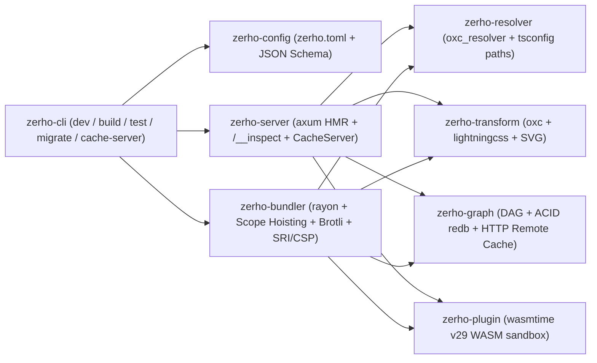

<div align="center">
  <a href="https://zerho.xyz">
    
  </a>

  <h1>zerho</h1>
  <p><strong>Zero-Node, 100% Safe Rust frontend dev server, test runner, and production bundler.</strong></p>

  <p>
    <a href="https://zerho.xyz"></a>
    <a href="https://github.com/glastor-core/jester/releases/tag/v1.0.0"></a>
    <a href="https://github.com/glastor-core/jester/actions/workflows/ci.yml"></a>
    <a href="https://github.com/glastor-core/jester/actions/workflows/audit.yml"></a>
    <a href="LICENSE-MIT"></a>
  </p>

  <p>
    <a href="#installation">Installation</a> ·
    <a href="#quick-start">Quick Start</a> ·
    <a href="#migrate-from-vite-in-1-command">Migrate from Vite</a> ·
    <a href="#real---release-benchmarks">Benchmarks</a> ·
    <a href="#architecture">Architecture</a> ·
    <a href="https://zerho.xyz/docs">Docs</a>
  </p>
</div>

---

`zerho` ships as a **single stripped native Rust binary** (`unsafe_code = "forbid"`, `clippy::pedantic -D warnings`, **65/65** passing unit + real-app E2E tests) powered by **`oxc`**, **`lightningcss`**, **`oxc_resolver`**, **`redb`**, **`blake3`**, **`rayon`**, **`axum`**, and **`wasmtime v29`**.

Build, serve, test, and ship **React, Preact, TypeScript, Web Workers, `.wasm`, and Edge SSR** apps with declarative `zerho.toml` configuration — **zero Node.js processes, zero Babel/PostCSS/Rollup glue, zero 400 MB `node_modules` toolchain tax**.

---

## Installation

### Linux & macOS (1-line installer with SHA-256 verification)
```sh
curl -fsSL https://raw.githubusercontent.com/glastor-core/jester/main/scripts/install.sh | sh
```

### Windows PowerShell (1-line installer with SHA-256 verification)
```powershell
irm https://raw.githubusercontent.com/glastor-core/jester/main/scripts/install.ps1 | iex
```

### From Source (Cargo · Rust 1.95+)
```bash
cargo install --git https://github.com/glastor-core/jester zerho-cli
```

> Pre-compiled binaries with `.sha256` checksums and CycloneDX SBOM are published on [GitHub Releases](https://github.com/glastor-core/jester/releases). Homebrew (`packaging/homebrew/zerho.rb`) and Scoop (`packaging/scoop/zerho.json`) manifests are also included.

---

## Quick Start

```bash
# Scaffold a Zero-Node React + TypeScript project in milliseconds
zerho init my-app --template react-tsx
cd my-app
zerho dev                    # axum dev server + React Fast Refresh + /__inspect Live Treemap

# Run built-in Zero-Node TS/JS tests (no Vitest, no Node.js)
zerho test

# Full-graph static audit (broken imports, cycles, missing .env, client secrets)
zerho check

# Scope-hoisted, minified, Brotli-compressed build + interactive dist/stats.html
zerho build --analyze

# Emit a DOM-free Edge SSR bundle (dist/server.mjs) for Cloudflare Workers / Deno / Node / Bun
zerho build --ssr

# Preview dist/ locally with automatic Accept-Encoding: br negotiation
zerho preview --port 4173

# Start a standalone pure-Rust HTTP remote team cache daemon
zerho cache-server --port 9000 --token "$ZERHO_CACHE_TOKEN"
```

---

## Migrate from Vite in 1 Command

```bash
zerho migrate --dry-run   # preview generated zerho.toml
zerho migrate             # writes zerho.toml + zerho.schema.json
```

`zerho migrate` inspects `vite.config.{ts,mts,js,mjs}`, `package.json`, `index.html`, and `tsconfig.json` and generates a validated declarative `zerho.toml` replacing multiple Node plugins with native Rust defaults:

| Capability | Typical Vite Setup | `zerho v1.0.0` (Built-In) |
| :--- | :--- | :--- |
| Runtime & Footprint | Node.js + npm plugins (`~240 MB`) | Single native Rust binary (`16.60 MB`) |
| TS / JSX / Fast Refresh | `@vitejs/plugin-react` + esbuild/oxc | 100% in-process `oxc` + `$RefreshReg$` |
| `tsconfig.json` `paths` | `vite-tsconfig-paths` | Native `oxc_resolver` |
| Brotli + Bundle Analyzer | `vite-plugin-compression` + visualizer | `build.brotli = true` + `--analyze` (`dist/stats.html`) + `/__inspect` Treemap |
| Security (SRI / CSP / Secrets) | Multiple external plugins | Native SHA-384 SRI, `dist/csp.json`, Gzip budgets & Secret Leak Guard |
| Plugin Isolation | Full-privilege Node.js JS plugins | Fuel-metered `wasmtime v29` WASM (`zerho:plugin@0.1.0`) |
| Testing | Vitest + Node.js | Built-in `zerho test` (`oxc` evaluator) |

---

## Capabilities (`v1.0.0`)

- **Compiler & Assets (`zerho-transform`):** Sub-millisecond `oxc` TS/JSX transforms, native React Fast Refresh, `oxc_minifier` + `oxc_mangler` + DCE, lexical Scope Hoisting, Barrel File Optimizer, deep multi-file CommonJS ↔ ESM pre-bundler, `lightningcss` CSS Modules + `@import`/`url(...)` rewriting, Web Worker `new URL(..., import.meta.url)` rewriting, and pure-Rust SVG/WebP optimization.
- **Dev Server & Cache Daemon (`zerho-server`):** Zero-Node `axum` + `tokio` + `notify` dev server, granular WebSocket HMR (`import.meta.hot`), Shadow DOM Error Overlay, zero-waterfall Dev Partial Bundling (`/@zerho/bundle`), HTTP reverse proxy (`[server.proxy]`), built-in `/__inspect` UI with **Live Bundle Treemap**, Brotli `PreviewServer`, and standalone `zerho cache-server` HTTP CAS daemon.
- **Bundler, MPA, Library & Edge SSR (`zerho-bundler`):** `rayon` wave-parallel builds, incremental ACID `redb` + HTTP remote team cache (`cache.remote_url`), Shared Chunks + `<link rel="modulepreload">`, Multi-Page Apps (`[build.entries]`), Library Mode (`[build.lib]` `.mjs`/`.cjs`), Web Worker chunks + `.wasm` `WebAssembly.instantiateStreaming` loaders, Edge SSR (`--ssr`), Brotli `.br`, SHA-384 SRI, `dist/csp.json`, Gzip budgets, `zerho check`, and `dist/stats.html`.
- **WASM Plugin Ecosystem (`zerho-plugin`):** Fuel-metered `wasmtime v29` sandbox with UTF-8 linear-memory hooks (`zerho_alloc`, `zerho_resolve_id`, `zerho_load`, `zerho_transform`) plus standalone Rust → `wasm32-unknown-unknown` plugins in [`examples/wasm-plugin/`](examples/wasm-plugin/README.md) and [`examples/plugins/`](examples/plugins/) (`vue-sfc`, `svelte`, `solid`).

> **Honest Scope:** Ideal today for React, Preact, TypeScript SPAs, MPAs, libraries, Web Workers/`.wasm`, and Edge SSR without Node.js. If your app depends heavily on Vue SFC, SvelteKit, Nuxt, or legacy Rollup/Vite JS plugins, stay on Vite for now.

---

## Real `--release` Benchmarks

> **Reference Environment:** `Windows 11 x86_64 (NT 10.0.26300.0)` · `AMD Zen 3 (16 logical threads)` · `rustc 1.96.1` · `zerho --release` (`16.60 MB`). Neutral `zerho` vs `Vite` CI benchmarks also run automatically on `ubuntu-latest` via [`.github/workflows/benchmarks.yml`](.github/workflows/benchmarks.yml). Full methodology in [`benchmarks/BENCHMARKS.md`](benchmarks/BENCHMARKS.md) and [`benchmarks/results.json`](benchmarks/results.json).

| Project | Cold Oxc Transform | Warm `redb` Lookup | Cold Build *(empty cache)* | Warm Build Min *(redb hot)* | Entry Size *(Raw / Gzip / Brotli)* |
| :--- | :---: | :---: | :---: | :---: | :---: |
| `examples/basic-ts` (3 mods) | **0.553 ms** | **0.0017 ms** *(1.7 µs)* | **43.04 ms** | **19.32 ms** | 804 B / 543 B / **458 B** |
| `examples/react-tsx` (5 mods + split) | **0.548 ms** | **0.0020 ms** *(2.0 µs)* | **60.27 ms** | **29.18 ms** | 2.28 KB / 1.09 KB / **1.00 KB** |
| `synthetic-500-modules` (500 TS mods) | **1.266 ms** | **0.0435 ms** | **1,254 ms** | **763.53 ms** *(655 mods/s)* | 17.37 KB / 2.73 KB / **1.53 KB** |

Reproduce on your own hardware in one command:
```bash
cargo build --release -p zerho-cli && ./target/release/zerho bench --synthetic 500 --iterations 5 --json
```

---

## Architecture



| Crate | Responsibility |
| :--- | :--- |
| `zerho-core` | Core identifiers (`ModuleId`, `blake3` `ContentHash`), `ModuleKind`, `Framework`, and typed error hierarchy |
| `zerho-config` | Declarative `zerho.toml` parser, validator, MPA/SSR/budgets/security/lib/remote-cache config, and JSON Schema generator |
| `zerho-resolver` | Native ESM/CJS & `tsconfig.json` `paths` resolution powered by `oxc_resolver`, `package.json`, and virtual modules |
| `zerho-graph` | Incremental module graph, DFS cycle detector, embedded ACID `redb` cache, and HTTP remote team cache |
| `zerho-plugin` | Native `Plugin` trait (`DefinePlugin`), fuel-metered `wasmtime` v29 host with UTF-8 string hooks, and `zerho:plugin@0.1.0` WIT contract |
| `zerho-transform` | `oxc` TS/JSX/React Fast Refresh compiler, `oxc_minifier`/`oxc_mangler`, Scope Hoisting, Barrel & CJS pre-bundler, Web Workers, CSS `@import`/`url()`, SVG optimizer |
| `zerho-server` | Zero-Node `axum` + `tokio` + `notify` dev server, WebSocket HMR, `/@zerho/bundle`, `/__inspect` Live Treemap, Brotli `PreviewServer`, and `CacheServer` |
| `zerho-bundler` | `rayon` parallel bundler, incremental `redb` cache, Shared Chunks + `modulepreload`, MPA, Library Mode, Web Workers/`.wasm`, Edge SSR (`--ssr`), WebP, `zerho check`, `dist/stats.html` |
| `zerho-cli` | Single binary CLI (`init`, `migrate`, `dev`, `build`, `check`, `preview`, `test`, `cache-server`, `bench`, `schema`, `wit`) |

---

## Continuous DevSecOps & Supply-Chain Verification (GLASTOR® Core)

`zerho` dogfoods the **GLASTOR® Core** security and verification toolchain on every push, pull request, and tagged release (`.github/workflows/audit.yml` & `.github/workflows/release.yml`), with all actions pinned to 40-character commit SHAs:

| Tool | Role in `zerho` CI/CD | Output / Gate |
| :--- | :--- | :--- |
| **[GLASTOR® Specter](https://specter.glastor.es)** | Zero-compiler Rust AST public API contract differ & Trojan Breaking-Change guard across all 9 crates | SemVer gatekeeper + SARIF 2.1.0 + CycloneDX SBOM |
| **[GLASTOR® Byte-Gauge](https://github.com/glastor-core/byte-gauge)** | SIMD binary hardening auditor on compiled `zerho` release binaries (ASLR/PIE, NX/DEP, Shannon entropy, stripped symbols, `< 25 MB` budget) | Release gate + `zerho-x86_64-unknown-linux-gnu.sbom.cdx.json` attached to GitHub Releases |
| **[GLASTOR® pii-veil](https://pii-veil.glastor.es)** | Sub-millisecond Rust DLP scanner auditing `crates/` for accidental PII or credential leaks | Continuous DLP telemetry |
| **[GLASTOR® Nemesis](https://github.com/glastor-core/nemesis)** | Universal DevSecOps auditor (Gitleaks secret scan, Semgrep SAST, Trivy SCA, license compliance, repo hygiene) | Weekly + PR/push SARIF upload to GitHub Security |

---

## License & Ecosystem

Dual-licensed under **[MIT](LICENSE-MIT)** OR **[Apache-2.0](LICENSE-APACHE)**.

<div align="center">
  <sub>Part of the <strong>GLASTOR® Rust Toolchain</strong> — <a href="https://zerho.xyz">zerho.xyz</a> · <a href="https://glastor.es">glastor.es</a> · <a href="https://pii-veil.glastor.es">pii-veil</a> · <a href="https://specter.glastor.es">specter</a></sub>
</div>
